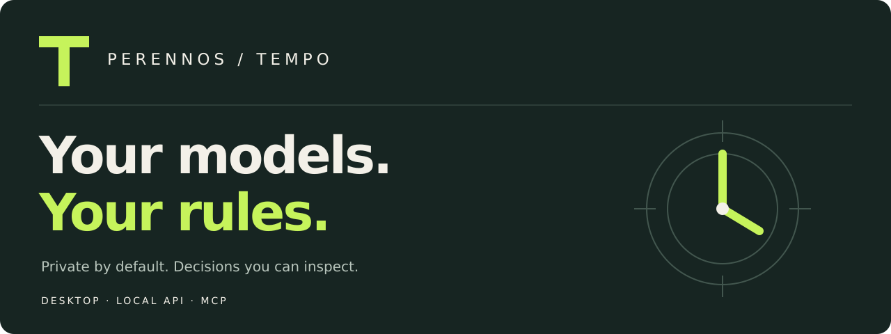

[](https://github.com/Perennos/perennos-tempo/actions/workflows/ci.yml)
[](LICENSE)

**A local-first AI routing core with a native desktop, a loopback API, and an MCP bridge.**

Tempo applies privacy rules before choosing a route, admits local work against available resources, and records content-free receipts. Use your local engines through one interface, with explicit owner approval for any hosted lane.

[Setup guide](SETUP-GUIDE.md) · [Troubleshooting](docs/TROUBLESHOOTING.md) · [Architecture](docs/ARCHITECTURE.md) · [Roadmap](docs/ROADMAP.md) · [Perennos](https://perennos.com/tempo)

## Start here

| You want to… | Start with… |
| --- | --- |
| Install on Windows | [Releases](https://github.com/Perennos/perennos-tempo/releases) and the [setup guide](SETUP-GUIDE.md). Check the exact build's checksum and acceptance evidence. |
| Understand a failed install | `python tempo.py doctor --home "YOUR_DATA_FOLDER"` — read-only, offline diagnostics. |
| Open an existing install | `python tempo.py gui --home "YOUR_DATA_FOLDER"` |
| Connect a local MCP client | `python tempo.py mcp-config --home "YOUR_DATA_FOLDER"` |
| Work on the source | [Contributing](CONTRIBUTING.md), then the dependency-free checks below. |

**Source candidate:** features on this branch require a rebuilt installer before installed Windows users receive them. A passing source test is not Windows installation acceptance. Installers are unsigned; keep Windows security protections enabled.

## What makes Tempo useful

- **Private by default.** The default profile is local with a zero hosted cost cap. The offline profile requires loopback inference. Explicit provider attachment, privacy checks and a positive owner-set spend cap gate hosted routes.
- **Real follow-ups.** Desktop chats include recent completed turns in memory: up to 12 turns within a 12,000 UTF-8 byte context budget. Oldest complete turns drop first. New chat or closing the window clears conversation state; no chat history file is created.
- **A small local interface.** Use the native desktop, the OpenAI-style `/v1/chat/completions` API, or three bounded MCP tools: `status`, `listmodels`, `ask`. The API does not implement the full OpenAI API, and MCP `ask` remains a single-message call.
- **Decisions you can inspect.** Routing, admission and completion receipts capture metadata without storing chat text in the receipt. A receipt does not certify answer accuracy.
- **Failure is visible.** Read-only diagnostics distinguish recorded setup gates from authenticated gateway access. Stopping a wait never silently replays a request or switches it to the cloud.
- **No extra stack for these features.** Conversation handling and diagnostics use Python's standard library. Actual inference still requires the runtime, dependencies and models described in setup.

The desktop also provides explicit Copy answer, New chat and elapsed waiting status. Copy answer puts the selected answer on the OS clipboard; clipboard history or sync follows your OS settings.

## Diagnose without guessing

```sh
python tempo.py doctor --home "YOUR_DATA_FOLDER"
python tempo.py doctor --home "YOUR_DATA_FOLDER" --connect --port 8765
```

The first command reads bounded local files without network access. The second additionally verifies gateway identity and performs an authenticated loopback model-listing request. Neither generates an answer, downloads anything, changes configuration, or exports tokens, model names, paths or chat contents. Diagnostics report fixed recovery hints and return exit code 1 when a required check fails. A connected passing report verifies access, **not** live model readiness.

For an already configured source install:

```sh
python tempo.py headless --home "YOUR_DATA_FOLDER" --device auto
# In another terminal:
python tempo.py status --home "YOUR_DATA_FOLDER"
python tempo.py gui --home "YOUR_DATA_FOLDER"
```

Use the port selected by your installer if it differs from 8765. Do not point `--home` at the source checkout or another owner's data.

## Check the source

Python 3.12; no model downloads or hosted credentials required:

```sh
python -m unittest discover -s tests -v
python -m unittest discover -s acceptance -p 'test_*.py' -v
python -m compileall -q .
```

CI runs source checks on Linux and Windows. Native installer, actual inference, desktop screenshots and API/MCP acceptance are separate checks. See [research decisions](docs/research/2026-10-23-product-decisions.md) for the evidence behind the improvement priorities.

## Boundaries that matter

`TEMPO_HOME` separates one workspace's data; it is not an OS security boundary. Separate owners need separate OS accounts or machines. The gateway binds to `127.0.0.1`; this core is not a shared office server. An owner-approved private remote host may process requests even under local policy. Review its trust boundary.

The public core excludes customer prompts, office profile packs, owner configuration and history, priors, benchmark data, weights and private workspace integrations. The [manifest](MANIFEST.json) defines the closed installer payload; tests and development plans stay outside it.

First setup requires network access and several gigabytes of storage for dependencies and models. Larger model contexts increase memory use; the desktop's byte budget is a transport/memory bound, not a tokenizer guarantee. The selected engine may impose a smaller context window.

Perennos-authored core files use Apache-2.0; third-party terms remain separate. Read [NOTICE](NOTICE.md), [security guidance](SECURITY.md), [profiles](PROFILES-README.md), [deployment options](DEPLOYMENT-OPTIONS.md), and the [buyer guide](BUYER-GUIDE.md).
