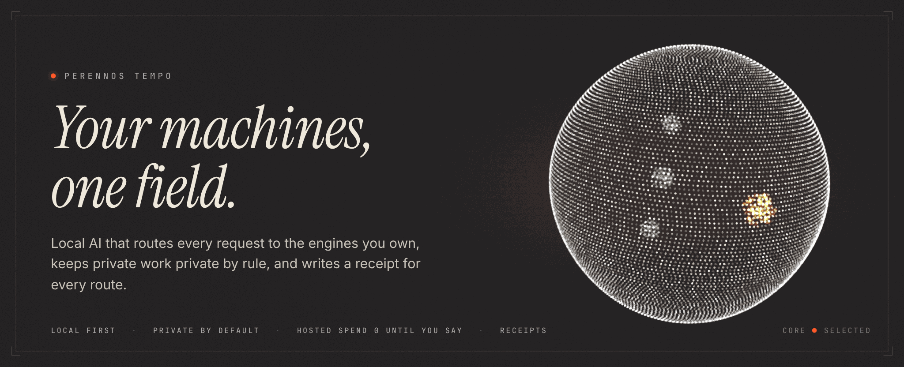
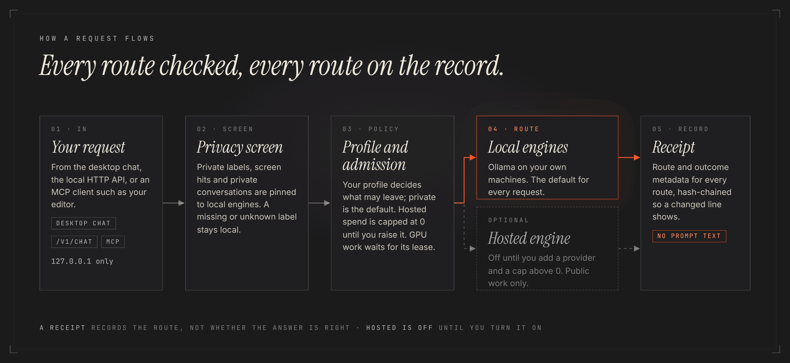
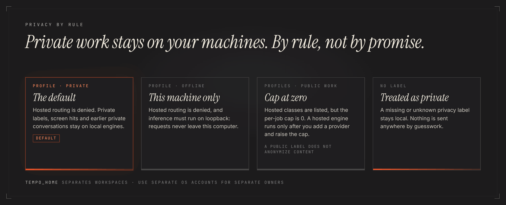

<p align="center">
  
</p>

<p align="center">
  <a href="https://github.com/Perennos/perennos-tempo/releases/latest"></a>
  <a href="https://github.com/Perennos/perennos-tempo/actions/workflows/ci.yml"></a>
  <a href="LICENSE"></a>
  
  
</p>

<p align="center">
  <b>Perennos Tempo</b> is local AI that answers to you. It routes every request to the engines on your own machines,<br>
  applies privacy and admission rules you can read, and writes a receipt for every route.<br>
  <sub>Free to use, change and share, for yourself or your business. Source-available under PolyForm Shield.</sub>
</p>

<p align="center">
  <a href="https://github.com/Perennos/perennos-tempo/releases/latest"><b>Download</b></a>&nbsp;&nbsp;·&nbsp;&nbsp;
  <a href="SETUP-GUIDE.md"><b>Setup guide</b></a>&nbsp;&nbsp;·&nbsp;&nbsp;
  <a href="PROFILES-README.md"><b>Profiles</b></a>&nbsp;&nbsp;·&nbsp;&nbsp;
  <a href="https://perennos.com/tempo"><b>perennos.com/tempo</b></a>
</p>

<br>

## Why Perennos Tempo

<table>
  <tr>
    <td width="33%" valign="top">
      <h3>Private by rule</h3>
      Private labels, screen hits and private conversations stay on local engines. A missing label stays local. Hosted engines stay off until you add one yourself and set a cap above zero.
    </td>
    <td width="33%" valign="top">
      <h3>Your hardware</h3>
      Runs local engines through Ollama on the machines you already own. CPU works with the default setup; GPU work waits for a lease, so jobs take turns instead of fighting over it.
    </td>
    <td width="33%" valign="top">
      <h3>Receipts, not promises</h3>
      Every route writes a hash-chained receipt: which engine, why, and how it went. Receipts refuse prompt text, so the record is safe to keep.
    </td>
  </tr>
</table>

## How a request flows

<p align="center">
  
</p>

1. **In.** A request arrives from the desktop chat, the local HTTP API or an MCP client. Everything listens on `127.0.0.1`.
2. **Screen.** Private labels, screen hits and private conversations are pinned to local engines.
3. **Policy.** Your profile decides what may leave. Hosted spend is capped at 0 until you raise it, and GPU work waits for its lease.
4. **Route.** A qualified local engine answers. A hosted engine is used only for public work, and only after you have configured it.
5. **Record.** A metadata-only receipt is written. Chat responses carry its id in the `x-tempo-receipt-id` header.

## Privacy by rule

<p align="center">
  
</p>

| Profile | What it does |
|---|---|
| `private` | The default. Hosted routing is denied. |
| `offline` | Hosted routing is denied and inference must use loopback. |
| `design-studio`, `frontier-assist` | Public-work profiles. Hosted classes are listed, but the per-job cap is 0. |
| `custom` | An empty policy slot, with no prompt pack and no hosted permission. |

A profile never declassifies a request, and a public label does not anonymize content. Full details are in [PROFILES-README.md](PROFILES-README.md).

## What's in the box

| Product | What it gives you | Start it |
|---|---|---|
| **Tempo Agent** | A local AI agent for your own computer: it reads and edits files, runs commands and reads web pages, asking before anything that matters; `/undo` puts its last changes back, your own hooks run around its steps, and `/stop` ends its background commands. Projects can give it standing instructions (`AGENTS.md`, `CLAUDE.md`). | `tempo-local-agent`, or `tempo-launch open agent` |
| **Tempo Vault** | Your notes as plain Markdown files, Obsidian-compatible. The agent reads and links them; Tempo learns from them on your computer. | `tempo-launch open vault` |
| **Tempo Studio** | Mixing and mastering: loudness, analysis and REAPER sessions, through the agent or its own commands. | `tempo-studio` |
| **Tempo Room** | A private group chat on your computer. Invite family or a team with a one-time link; anyone in the room can ask `@tempo`. Guests never get tools, files or your memory. | `tempo-launch open room` |
| **tempo-launch** | Starts and stops everything without a console window, and sets Tempo up for this computer: it checks the memory, graphics card and disk, recommends models that fit, and fetches them (and Ollama itself, checked against a pinned SHA-256) only after you say yes. | `tempo-launch setup` |
| **Desktop chat** | A local chat window on top of the gateway. | `python tempo.py gui --home "<data-folder>" --port 8765` |
| **Headless API** | `GET /health`, plus authenticated `GET /v1/models` and `POST /v1/chat/completions`, on `127.0.0.1`. | `python tempo.py headless --home "<data-folder>" --host 127.0.0.1 --port 8765 --device cpu` |
| **MCP bridge** | `ask`, `listmodels` and `status` for editors and MCP clients, over stdio. The token never goes into client config. | `python tempo.py mcp-config --home "<data-folder>" --port 8765` |

The gateway behind the last three applies five generic **profiles** with a validator and a privacy boundary, and no customer prompts ([PROFILES-README.md](PROFILES-README.md)). It writes append-only, hash-chained **receipts** for every route and outcome, and gives GPU work **admission** and a lease gate.

Each app keeps its data in one Tempo home folder per computer ([docs/TEMPO-HOME.md](docs/TEMPO-HOME.md)); setup is described in [docs/TEMPO-SETUP.md](docs/TEMPO-SETUP.md). Talking to Tempo, with speech that never leaves your computer: [docs/TALK-TO-TEMPO.md](docs/TALK-TO-TEMPO.md). Big jobs as sections and takes, with budgets and a stop switch: [docs/SECTIONS.md](docs/SECTIONS.md). Your models getting better at their parts from your best takes (Lessons, the nightly Woodshed, the Mix): [docs/WOODSHED.md](docs/WOODSHED.md). Your own frontier model editing a local model's weights, kept only if it wins (Retune): [docs/RETUNE.md](docs/RETUNE.md). Stage (video and image workflows on your own ComfyUI: re-angle, character swap, effects, camera moves, relight, lip sync, with Pedals to change them, played by you or by the AI as tools): [docs/STAGE.md](docs/STAGE.md), and whose work it is built on: [docs/STAGE-SOURCES.md](docs/STAGE-SOURCES.md).

## Quick start

**The apps, from a release.** Open the [latest release](https://github.com/Perennos/perennos-tempo/releases/latest) and download the file for your computer:

| Computer | File |
|---|---|
| Windows 10 and 11 (x64) | `PerennosTempo-Setup-<version>-x64-source-available.exe` |
| macOS, Apple silicon | `perennos-tempo-source-available-<version>-aarch64-apple-darwin.tar.gz` |
| Linux (x86_64) | `perennos-tempo-source-available-<version>-x86_64-unknown-linux-gnu.tar.gz` |
| Debian and Ubuntu (x86_64) | `perennos-tempo-source-available_<version>-1_amd64.deb` |

`<version>` is the version in the latest release's asset filenames.

- **Windows:** download the Setup file and double-click it. The installer is not code-signed, so Windows may show "Windows protected your PC": click **More info**, then **Run anyway**.
- **macOS and Linux:** unpack the `.tar.gz` and run `./install.sh`. On Debian and Ubuntu, `sudo apt install ./<file>.deb` works too.
- **Check a download** (optional): compare its SHA-256 with `SHA256SUMS.txt` on the release page, or run `gh attestation verify <file> --repo Perennos/perennos-tempo`, which checks that this repository's release workflow built it.

Then run `tempo-launch setup`. It shows the exact plan and the free space, and downloads nothing large until you say yes.

**From source (headless).** With Python 3.12 or newer, a prepared data folder and a local engine:

```sh
python tempo.py headless --home "<data-folder>" --host 127.0.0.1 --port 8765 --device cpu
```

Then connect an MCP client with the entry printed by `python tempo.py mcp-config --home "<data-folder>" --port 8765`. The [Setup Guide](SETUP-GUIDE.md) covers the token, the MCP client and the Linux source path.

**The apps, on macOS and Linux.** With Rust and a C compiler:

```sh
bash installer/unix/install.sh --from-source .
tempo-launch setup
```

`install.sh` builds the agent, Vault, Studio, Room and `tempo-launch`, adds menu entries (an app in `~/Applications` on macOS), and `--uninstall` moves everything it installed to a trash folder. See [installer/unix/README.md](installer/unix/README.md).

**The apps, on Windows.** `installer/windows/build.ps1 -Apps vault,studio,room` builds the installer with [Inno Setup](https://jrsoftware.org/isinfo.php); see [installer/windows/README.md](installer/windows/README.md).

## Defaults and limits

The default profile is local and has a zero hosted cost cap. Provider attachments and positive spend caps require explicit owner configuration. A public label does not anonymize content. If a hosted engine is configured, that provider receives the request; never send sensitive material to an unreviewed hosted route.

`TEMPO_HOME` separates one workspace's data; it is not an operating-system security boundary. Use a separate OS account or machine for separate owners. The API binds to `127.0.0.1`; this release does not provide a shared office server or LAN authorization. Receipts record routing and outcome metadata; they are not proof that a response is correct.

The installer is not code-signed; keep Windows security protections enabled. Check downloads against `SHA256SUMS.txt` on the [release page](https://github.com/Perennos/perennos-tempo/releases/latest). Multi-user security and shared office deployment are outside this release.

Models and Ollama are fetched only after you say yes (`tempo-launch setup`), and need network access and several gigabytes of free storage. The repository contains no runtime binaries or model weights.

This public core leaves out private onboarding interviews, customer or office profile packs, vertical-specific setup choices, desks and approvals UX, owner configuration and history, owner priors, benchmark data, model weights, the private resident adapter and optional workspace integrations. The export manifest records its exact file set and exclusions. See also [Deployment Options](DEPLOYMENT-OPTIONS.md) and the [Buyer Guide](BUYER-GUIDE.md).

## Licence

Perennos-authored files are offered under the [PolyForm Shield License 1.0.0](LICENSE). You may use, change and share Perennos Tempo, for yourself or for your business, and you may contribute back. You may not use it to provide a product that competes with Perennos Tempo. Releases before 6 November 2026 keep their Apache-2.0 terms. Third-party source, runtimes, dependencies and model files keep their own terms; see [NOTICE.md](NOTICE.md).

## Contributing and security

**Trying the beta?** [TESTING.md](TESTING.md) says what to try and how to report what you find.

Contributions are welcome. They come in under Apache-2.0 with a sign-off (`git commit -s`), so they can go into every edition of Perennos Tempo; see [CONTRIBUTING.md](CONTRIBUTING.md). To report a security issue, see [SECURITY.md](SECURITY.md). What the apps keep and what leaves your computer: [PRIVACY.md](PRIVACY.md).

<br>

<p align="center"><sub>Made by <a href="https://perennos.com">Perennos</a></sub></p>
